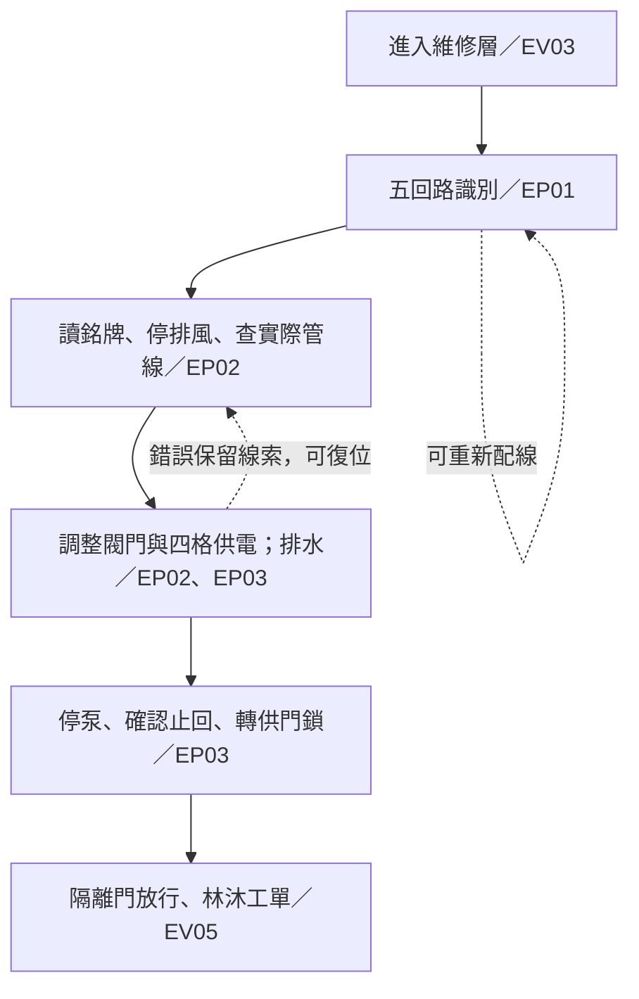

# 《黃燈之後》地下一層 · MW 獨立試玩交接

本輪由使用者明確選定「先獨立製作地下一層三房間、三謎題，測試後交 TI／小雪」。本入口只實作配電室、泵房與隔離門前廳，最後停在林沐署名工單。地下二、三層及最終結局未製作；沒有將候選結局當成事實。

原遊戲的 `Game/`、`content/story.json`、入口、套件、設定、封存及既有驗收文件均未修改。`npm run dev` 仍開原遊戲；B1 使用自己的入口、設定、產物及存檔。

## 版本與來源

- 產品基準：`main@20261ffc44a76f0975647ffb2f3f0f769351081a`。
- SC 提案來源：[codex/expanded-story-plan@32acc19](https://github.com/kevinliao998-bot/EscapeRoom/tree/32acc19)，對照 `docs/Expanded-Story-Plan.md`、`docs/Expanded-Story-Verify.md` 的 EV03–EV05、EP01–EP03。
- `proposal.json` 是該提交 `content/expanded-story-proposal.json` 的逐位元組快照，Git blob 為 `db93d3e7fabb4a3bf4533557db5ed702eba2f1cd`。只使用 EP01–EP03、三級提示及 midpointReveal。保留整份原稿供核對，其餘候選資料不在遊戲中呈現。
- SC 分支基於較早的版本，不能整支覆蓋目前 main；本輪只新增 `Expansion/`。未整合另一條英文語言分支。

## 啟動與建置

在倉庫根目錄執行。需要 Node 24、專案現有依賴；未安裝時先 `npm ci`。

```sh
node node_modules/vite/bin/vite.js --config Expansion/vite.config.ts
```

開啟終端顯示的 `http://127.0.0.1:4174/`。原版仍可同時使用 4173。

```sh
node node_modules/typescript/lib/tsc.js -p Expansion/tsconfig.json
node node_modules/vite/bin/vite.js build --config Expansion/vite.config.ts
node node_modules/vite/bin/vite.js preview --config Expansion/vite.config.ts
```

獨立產物在 `dist-b1.local/`，符合原有 `*.local` 忽略規則，不覆寫原版 `dist/`。使用 Phaser 3.90.0、TypeScript 5.9.3、Vite 7.3.7；沒有新增依賴。

## 操作

- 點擊場景中可觀察的設備；頂部房間導航及底部通道可隨時往返。
- 線束先選取、再放入插槽；可以移動已放的線束，不會遺失。
- 閥門及分路開關可重設；超載與水位保護會拒絕接通，並說明原因。
- Tab／Shift+Tab 選擇、Enter／空白啟動、Escape 關閉或回上一頁。所有機關都可用按鈕操作，無須拖曳或精準點小物件。
- 「顯示可調查處」只顯示互動位置，不顯示答案；筆記只保留已閱讀文件。
- 設定提供加大文字、減少動態、靜音及提示音音量。所有線索可靜音完成。

## 機關與狀態契約

| 項目       | 實作與可恢復條件                                                                                                                       | 對照                |
| ---------- | -------------------------------------------------------------------------------------------------------------------------------------- | ------------------- |
| 回路識別   | 從工單、固定架、接頭／維修圖讀到五項約束；正解唯一。錯配保留草稿，所有線束可再移動。成功後鎖定接線，避免重複校驗重設正在進行的設備供電 | EP01／B1-01、02、12 |
| 回流追查   | 有照明且停止排風後，可從檢修窗讀到 C 回流支路，寫入筆記；不以「已讀」作為排水的隱藏硬門檻                                              | EP02／B1-03、04     |
| 有限供電   | 上限 4 格。保留照明後，排水與門鎖分階段供電。高水位、超載或缺少作業照明時拒絕接通，不清進度                                            | EP03／B1-05、06     |
| 排水與止回 | A/B 開、C/D 關且泵浦有電才可排水。排水操作以一次完成的設備循環模擬，沒有計時懲罰。停止泵浦後止回閥閉合，水位保持安全                   | EP02、03／B1-03、06 |
| 工單揭露   | 水位安全、泵浦停止、止回閥閉合、照明及門鎖供電時，隔離門放行。呈現原文「照明保留。先讓走廊的人出去。」；不確認林沐去向                 | EV05／B1-06         |
| 存讀檔     | `amber-expansion-b1-v1`，設定另用 `amber-expansion-b1-prefs`。不讀寫原版 key。損壞原文保留；寫入失敗時匯出目前記憶體進度               | B1-07–10            |

初始閥門 A/B/C/D 都開、回路未辨認、所有分路未送電。回路識別後先恢復照明、通訊及排風，共 3 格。這些是本切片的 MW 初始狀態，SC 原稿沒有規定其初值。已讀文件及三級提示持久保存；沒有消耗品、追逐或倒數。



## 重跑檢查

```sh
node --experimental-strip-types --test Tests/*.test.ts Expansion/b1.test.ts
node Expansion/check-visuals.mjs
node Tests/check-source-integrity.mjs 20261ffc44a76f0975647ffb2f3f0f769351081a
```

`test-results.txt`、`browser-check.json` 及本目錄的場景／工單截圖保存 MW 本輪證據。測試由 MW 的工具操作完成，知道答案；不是新玩家盲測，不冒充 TI 驗收。完整範圍與限制見 `REVIEW.md`。

## 給下一位：TI／小雪

請以本 PR 的最終 head 為版本，依既有 HUAM 流程獨立複驗，不把上面的 MW 結果當作自己的驗收：

1. 重跑原版與 B1 測試、型別檢查、兩份建置，核對原版受保護檔案。
2. 從新局在不知道答案的情況下檢查入口、目標、工單與三題公平性；記錄耗時及卡住位置。
3. 純鍵盤走完三房間，檢查嵌套文件的返回、場景切換、Tab 循環、加大字、音量欄位；補實際螢幕閱讀器朗讀，不只檢查 DOM。
4. 實際下載 B1 JSON，核對還原後的水位、閥門、供電、工單與已讀線索；確認原版存檔仍可繼續。匯出目前記憶體的序列化已有單元測試，但本輪未獨立檢查下載到磁碟的 JSON。
5. 補實體手機觸控、耳機音量與小屏閱讀；檢查遮罩與文字對比。來源色板及宣告配色腳本不能取代實機閱讀。
6. 有問題留重現步驟及版本交 MW 修正；SC 檢查工單揭露與新增場景素材。完成組員審查前不自行合併到 main，不處理其他分支或封存。
