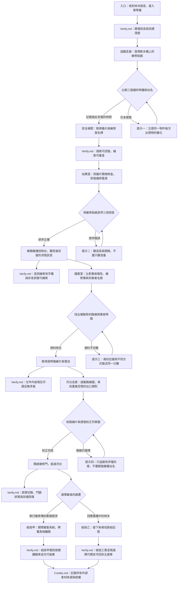

# 《黃燈之後》密室逃脫故事簡報

## 遊戲概念

- **類型：** 第一人稱 2D 點擊式密室逃脫
- **場景：** 一座被遺忘在城市地底的「第零層」轉運站。它像熟悉的辦公室與地下通道，卻在每次轉彎後悄悄改變。
- **預估遊玩時間：** 25–40 分鐘
- **核心體驗：** 玩家必須觀察環境中的微小矛盾、把線索串成可驗證的規則，並決定是否相信一段被剪接過的求救訊息。
- **內容原則：** 以孤立感、空間錯置和逐步揭露營造不安；不使用血腥畫面或突然大音量驚嚇。所有關鍵資訊都能透過觀察或提示取得。

## 故事簡介

凌晨 1:17，維修員林澄收到妹妹林沐傳來的語音：「末班車到了。聽見三聲就走黃線，別看站名。」林沐在一年前的第零層事故中失蹤，官方紀錄卻寫著她從未進入車站。

林澄循著訊息來到封閉的地下轉運站。入口後的走廊不斷回到同一台飲水機；牆上的站名、時鐘與廣播各自指向不同時間。玩家必須修復站務室的供電、辨識失真的廣播、校正列車路線圖，並打開通往月台的維修門。

沿途留下的維修記錄顯示：妹妹曾試圖關閉一套會複製乘客記憶的導引系統。求救訊息中的「三聲」不是列車提示，而是系統用來重播記憶的音訊標記。最後，林澄必須決定是跟著妹妹留下的維修程序關閉系統，還是相信廣播中那個聲稱「我就是林沐」的聲音。

## 遊戲目標與操作

玩家需要找到出口並揭露第零層事故的真相。主要互動包含：

- 點擊場景中的物件以觀察、檢查或使用。
- 將找到的物品放入背包，並在合適的物件上使用。
- 記錄時間、聲音節奏、符號與路線等線索。
- 可選擇逐級提示；提示只提醒觀察方向，不直接跳過謎題。
- 房間切換、背包、計時與存檔由遊戲機制實作；本文描述其故事需求。

## 故事流程圖

以下流程圖同時標出每個主要節點應連到 `Verify.md` 的驗證項目。實際謎題答案、狀態轉換與驗收條件應在 `Verify.md` 詳列。

## 謎題與障礙設計

### 1. 迴圈走廊：空間記憶

玩家經過同一台飲水機三次，每次周遭只有一項細節改變：時鐘分鐘、站名牌方向、地上的水漬形狀。維修貼紙提示「記錄不一致時，以留下實體痕跡的那次為準」。玩家檢查場景並比較變化，取得安全梯間的通行線索。

- **障礙：** 容易把重複房間當成沒有進展。
- **公平性：** 每次循環保留至少一項可比較的視覺差異；筆記可重看。
- **提示節奏：** 先提示「留意變化」，再指出時鐘與標牌，最後才解釋實體痕跡的用途。

### 2. 站務室：聽覺排序

檢修盒內有三段測試音，牆上維修貼紙用長短刻痕記下音序。玩家依音高和間隔排序，啟動廣播控制台。求救訊息混有三聲提示音，讓玩家開始懷疑原始訊息。

- **障礙：** 只靠聽力可能造成無障礙問題，也可能受播放設備影響。
- **公平性：** 每段音訊提供可重播按鈕、波形／長短視覺標記和文字描述；答案不要求精準辨音。
- **回饋：** 錯誤排序以柔和的繼電器聲回饋，不重置已完成的其他線索。

### 3. 檔案室：交叉比對

事故報告記載「1:17 無列車進站」，維修簿卻記有該分鐘的緊急斷電；名冊上林沐的簽名被刮除，但筆跡壓痕仍可見。玩家要比對三份資料，取得透明路線片與電池。

- **障礙：** 文件資訊量較大，玩家可能不知道哪些差異重要。
- **公平性：** 關鍵數字、日期與同一事件使用一致的視覺標記；檔案可隨時重查。
- **敘事效果：** 玩家從可核對的紀錄推理，不必猜測角色的心情或未公開設定。

### 4. 月台走廊：路線校正

路線圖覆蓋透明片後，部分站點重疊。只有仍供電的燈號代表真實通道；廣播反覆報出錯誤站名。玩家需忽略聲音指引，追蹤供電節點，校正列車圖並打開維修門。

- **障礙：** 聲音與圖像互相衝突，並測試玩家是否運用先前學到的規則。
- **公平性：** 供電燈號、路線片與前面維修記錄都支持同一解法；操作失誤可直接重試。
- **跨關卡連結：** 維修員名牌可固定路線片，電池可恢復月台指示燈。

### 5. 最終抉擇：相信證據或聲音

兩個結局都由玩家明確選擇，不設限時懲罰。關閉系統的結局回收維修簿線索；留下尋找林沐的結局回收廣播與失聯者名冊線索。選擇後以短場景交代代價，玩家可返回主選單。

## 美術方向

追求高完成度的 2D 場景插畫與一致的介面，而非依賴低解析度噪點或大量濾鏡製造恐怖感。

- **構圖：** 以寬螢幕橫向場景呈現空曠走廊，使用長透視線、偏移的門框與重複窗格暗示空間不穩。
- **色彩：** 以褪色米黃、冷綠、灰藍為基底；重要線索採克制的琥珀黃。每個區域保留足夠明暗對比，文字和互動標記清楚可辨。
- **材質：** 磨損壁紙、潮濕地磚、泛黃塑膠、氧化金屬和舊式壓克力站牌；細節服務於年代感及線索辨識。
- **光影：** 使用穩定的日光燈色溫，局部閃爍只在劇情節點短暫出現，避免持續閃光。
- **互動：** 可互動區域在游標移入或聚焦時以細線、輕微亮度變化標示；重要物件可放大檢視。
- **一致性：** 房間間重用材質、標牌字體和光源規則；改變少數元素來提示異常，不任意更換風格。
- **可讀性：** 提供字幕、可調文字大小、明確的焦點狀態與減少動態效果選項。

## 音效與音樂方向

音效需支持觀察與方向感，避免遮蔽提示或造成不適。

- **環境底音：** 遠處風管低鳴、日光燈微弱電流聲、偶爾的管線滴水；維持低音量與疏密變化。
- **位置線索：** 左右聲道可暗示通道來源，但同時提供畫面方向提示，不將立體聲聽力作為解謎必要條件。
- **互動音效：** 紙張翻動、金屬扣件、按鍵與繼電器採短促、柔和且不刺耳的音色。
- **廣播：** 以窄頻、低清晰度呈現；重要對白同步字幕，並可在檔案中重播。
- **音樂：** 使用稀疏的低音合成器與緩慢脈衝，在發現關鍵證據時短暫讓出空間，不用突然爆音驚嚇。
- **無障礙與控制：** 提供音量分項控制、靜音模式及音訊線索的文字／圖形替代。

## 內容製作與素材授權

- 故事、線索、提示、答案與狀態預期先寫入 `content/`，並以測試確認彼此一致。
- 圖像與音效素材放在 `assets/`；每項外部素材都要在 `Credits.md` 記錄作者、來源、授權及必要的署名方式。
- 不直接挪用《Backrooms》作品中的既有角色、文字、場景設計或音效。此遊戲只採用「無盡、似曾相識的異常空間」這類廣義氛圍作為靈感，並建立原創世界觀與美術表現。
- 圖像與音效尚未製作前，將本簡報視為製作方向，不宣稱已有最終素材。
