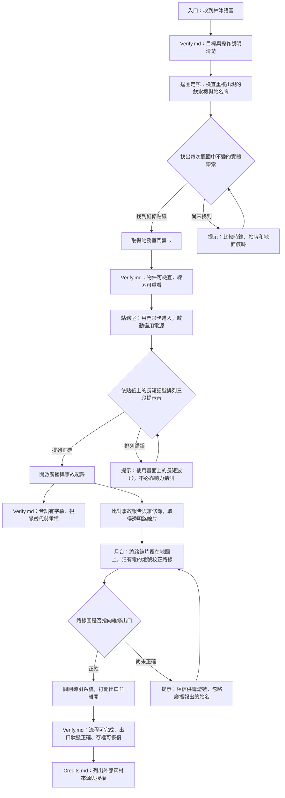

# 《黃燈之後》密室逃脫故事簡報

## 遊戲概念

- **類型：** 第一人稱 2D 點擊式密室逃脫
- **場景：** 城市地底一座被遺忘的「第零層」轉運站。熟悉的走廊與站務室會在玩家離開再返回時出現細微變化。
- **預估遊玩時間：** 10–15 分鐘，適合作為可完成的第一版作品。
- **製作範圍：** 三個主要場景、三個互相連結的謎題、一個主要結局。優先完成可遊玩的完整流程，再視時間增加內容。
- **核心體驗：** 觀察環境矛盾、把線索組合成明確規則，並思考一段語音是否真能證明說話者的身分。
- **氛圍：** 安靜、孤立、詭異但不強烈。不要使用血腥、追逐、突然出現的怪物、閃爍畫面或突發大音量。提供提示，讓玩家不會因卡關而被迫長時間停留在緊張場景。

## 故事簡介

凌晨 1:17，維修員林澄收到失蹤一年的妹妹林沐傳來的語音：「末班車到了。聽見三聲就走黃線，別看站名。」官方紀錄卻稱，林沐從未進入發生事故的第零層轉運站。

林澄循著訊息進入封閉車站。走廊似乎不斷回到同一台飲水機，站名牌和時鐘也互相矛盾。玩家在迴圈走廊找到維修線索，進入站務室恢復電力並整理事故紀錄，最後校正月台路線圖、打開出口。

線索揭露，一套舊導引系統會把乘客留下的聲音片段重新拼接。林沐曾試圖關閉它。玩家可以聽見像是林沐的回應，但無法確認那是否為她本人。主要結局中，林澄依照維修紀錄關閉系統，帶著仍未解答的疑問離開。

## 遊戲目標與操作

玩家需找到出口並拼出第零層事故的基本真相。

- 點擊場景物件以檢查或互動。
- 找到少量關鍵物品並放入背包；只在確實需要時使用物品組合。
- 線索可在遊戲內重看，避免依賴記憶。
- 每個謎題提供逐級提示；最後一級提示可說明操作方向，但不直接自動解題。
- 首版只需三個場景、基本背包、房間切換與瀏覽器本機存檔。計時器不是解謎條件；若實作，預設關閉或僅作遊玩紀錄。

## 故事流程圖

每個主要環節都連到 `Verify.md` 的驗證項目。具體答案、狀態轉換與驗收條件由 `Verify.md` 記錄。

## 謎題設計

### 1. 迴圈走廊：找出不變的線索

玩家看到同一台飲水機兩次。時鐘和站名牌改變，但貼在機身內側的維修標籤保持相同，並以圖示提示站務室門禁卡的位置。

- 場景只需一張走廊背景和少量物件狀態差異。
- 物件可放大檢視；玩家離開再返回時，提示仍可重看。
- 提示先提醒玩家比較場景，再指出可能需要檢查的物件。

### 2. 站務室：視覺化的提示音序列

牆上維修貼紙畫有三個長短符號，桌上的控制台顯示三段對應波形。玩家按貼紙順序點選波形，恢復備用電力並打開事故紀錄。

- 不要求玩家辨認音高；音效是氣氛與回饋，不是唯一線索。
- 錯誤時可立即重試，不清除已找到的線索。
- 事故報告與維修簿提供足夠資訊，讓玩家知道導引系統正在重播聲音片段。

### 3. 月台：校正路線並離開

玩家把站務室取得的透明路線片放在月台地圖上，依照有電的燈號找到出口。廣播會報出錯誤站名，但畫面同時清楚呈現可採信的線索。

- 可重複調整路線，不設倒數懲罰。
- 完成後播放關閉系統的短動畫或淡出畫面，呈現林澄離站。
- 結局保留林沐是否仍在系統中的懸念，不需製作分支結局。

## 美術方向

以可完成且一致的 2D 畫面為目標，優先清楚辨認互動物件與線索。

- 首版製作三張主要背景：迴圈走廊、站務室、月台。
- 迴圈感以重用走廊背景、替換少數站牌或時鐘素材呈現，不製作複雜的動態迷宮。
- 使用褪色米黃、冷綠、灰藍作底色，琥珀黃只用於關鍵線索和出口指示。
- 以簡單、穩定的光影和少量細節建立空間感；不要求每個物件都做獨立動畫。
- 互動物件有清楚的游標、焦點或外框提示；提供放大檢視、足夠文字對比與可調字級。
- 避免持續閃爍、快速鏡頭移動和突然變化的畫面。

## 音效與音樂方向

音效是氣氛補充，玩家關閉聲音後仍能完成所有謎題。

- 首版只需少量可循環的環境底音，例如低音量風管聲或日光燈電流聲。
- 製作簡單、短促的按鈕、門鎖和電力啟動回饋音；錯誤操作不使用刺耳警報。
- 廣播對白附繁體中文字幕，並可重播；關鍵語意同時寫在事故紀錄中。
- 提示音謎題提供波形或長短符號作為完整替代線索。
- 提供音量控制與靜音選項；不使用突發大音量、驚嚇音效或強制立體聲定位。

## 首版範圍與延伸內容

首版以完成「走廊 → 站務室 → 月台 → 出口」的短流程為準。以下項目只有在核心流程可玩且已檢查後才考慮加入：

- 額外檔案室、更多文件和額外謎題。
- 第二個結局或需要大量獨立畫面的分支劇情。
- 角色動畫、複雜的場景轉場、動態音樂系統。
- 計時挑戰、額外道具組合和更多可探索房間。

## 內容製作與素材授權

- 故事、線索、提示、答案與狀態預期放在 `content/`，並以測試確認彼此一致。
- 圖像與音效素材放在 `assets/`；外部素材須在 `Credits.md` 記錄作者、來源、授權及所需署名。
- 不直接挪用《Backrooms》作品中的既有角色、文字、場景設計或音效。只取用「熟悉卻異常的空間」這類廣泛氛圍作為靈感，並建立原創世界觀與視覺表現。
- 在素材尚未製作前，本簡報是製作方向，不代表最終圖像或音效已完成。
