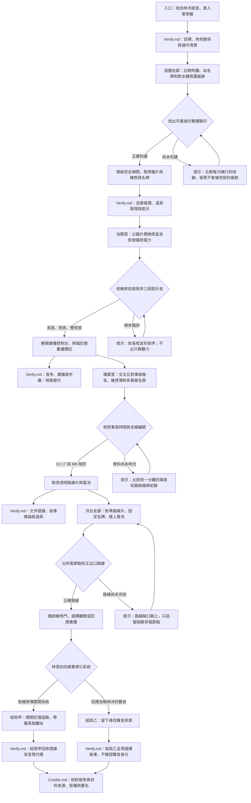

# 《黃燈之後》密室逃脫故事簡報

## 遊戲概念

- **類型：** 第一人稱 2D 點擊式密室逃脫
- **場景：** 城市地底被遺忘的「第零層」轉運站。熟悉的辦公室、地下通道和月台在玩家離開再返回後出現微小而可追查的變化。
- **預估遊玩時間：** 25–40 分鐘；實際時長需由未看答案的玩家測試。
- **內容範圍：** 入口與迴圈走廊、安全梯間、站務室、檔案室、月台走廊；四組主要謎題與兩個明確選擇的結局。
- **核心體驗：** 觀察環境矛盾、從文件和感官線索推導可驗證的規則，並判斷一段聲音是否足以證明說話者的身分。
- **氛圍：** 安靜、孤立、詭異但克制；不使用血腥、追逐、突然出現的怪物、頻閃或突發大音量。所有關鍵資訊都能透過觀察、字幕、視覺替代和提示取得。

## 故事簡介

凌晨 1:17，維修員林澄收到失蹤一年的妹妹林沐傳來的語音：「末班車到了。聽見三聲就走黃線，別看站名。」官方事故紀錄卻寫著，林沐從未進入第零層轉運站。

林澄循著訊息進入封閉車站。迴圈走廊不斷回到同一台飲水機；站名牌和時鐘互相矛盾，地面的水漬卻留下可查證的鞋印。玩家沿鞋印進入安全梯間取得維修工具，再到站務室恢復備用電力、辨識被剪接的廣播，並在檔案室比對事故報告、維修簿與失聯者名冊。最後，玩家在月台走廊校正路線圖、關閉導引系統並打開維修出口。

記錄顯示，舊導引系統會把乘客留下的聲音片段重新拼接。林沐曾試圖關閉它。廣播中有個聲音自稱林沐，但聲音相似並不能證明說話者就是她。林澄最後可以依維修程序關閉系統離開，或回應廣播留下來尋找聲音的來源。兩個結局都交代選擇的代價，不宣稱已確定林沐的命運。

## 遊戲目標與操作

玩家需要找到出口並拼出第零層事故的基本真相。

- 點擊場景物件以觀察、檢查或使用。
- 將找到的撬片、維修員名牌、透明路線片與電池放入背包，並在合適的設備上使用。
- 將時鐘、站名、聲音波形、事故時間及路線節點記錄在可重看的調查筆記中。
- 每個謎題提供逐級提示；最後一級可說明下一個操作方向，但不自動替玩家解題。
- 房間切換、背包、有效遊玩計時與瀏覽器本機存檔屬遊戲機制。計時不倒數、不造成失敗。
- 所有音訊線索同時提供繁體中文字幕、可重播內容及完整視覺替代。

## 故事流程圖

每個主要故事與謎題節點都連到 `Verify.md` 的驗證項目。具體答案、線索對應、狀態條件與驗收方法由 `Verify.md` 記錄。

## 謎題與障礙設計

### 1. 迴圈走廊：空間記憶

玩家繞行三次，每次只改變一項主要細節：時鐘前進、站名牌反轉、鞋印出現在水漬中。維修貼紙提示：「記錄不一致時，以留下實體痕跡的那次為準。」玩家比較可重看的快照，依鞋印找到安全梯間。

- **障礙：** 重複空間容易讓玩家以為沒有進展。
- **公平性：** 每次變化均可在調查筆記重看；鞋印出現後，畫面與文字都清楚指出方向。
- **提示節奏：** 由比較變化開始，逐步引導玩家注意水漬與鞋印，不以隱藏像素作為唯一答案。
- **道具：** 安全梯間取得撬片與維修員名牌。

### 2. 站務室：視覺化音序

玩家用撬片打開檢修盒並恢復備用電力。維修刻痕和控制台波形共同表示「長音 → 短音 → 雙短音」。正確排列後，控制台播放剪接訊息並開放檔案室。

- **障礙：** 玩家可能只憑聽覺猜測。
- **公平性：** 波形、長短符號、文字順序和可重播音效表達同一規則。
- **回饋：** 錯誤時提供柔和的繼電器聲及文字提示，不重置其他進度。
- **故事線索：** 語音中的三聲標記與控制台記錄吻合，證明系統重播聲音片段，但不能證明林沐的聲音仍是本人。

### 3. 檔案室：交叉比對

玩家檢查事故報告、維修簿和失聯者名冊，核對事故時間為 01:17、被刪除的維修支線為 M0。記錄顯示官方名冊遭到刮改，也說明導引系統如何重播聲音。正確比對後取得透明路線片與電池。

- **障礙：** 文件較多，玩家可能無法辨認相互關聯的資料。
- **公平性：** 每份文件都能重看；時間與支線資訊有一致標記，提示逐步指出要比較的欄位。
- **敘事效果：** 證據可反駁「林沐從未進站」，但不推斷廣播聲音的真實身分。

### 4. 月台走廊：路線校正

玩家把透明片缺口朝上放在路線圖上，用名牌固定並接上電池，再沿相鄰供電節點連至維修出口。錯誤站名廣播與可靠燈號形成衝突，測試玩家是否沿用先前得到的規則。

- **障礙：** 玩家可能跟著錯誤站名走，或把透明片方向放反。
- **公平性：** 維修簿、透明片缺口和供電燈號共同支持解法；錯誤可直接調整，不消耗道具、不倒數。
- **結局選擇：** 出口開啟後，玩家可關閉系統離開，或回應廣播並留下。兩種選擇皆有短結尾和返回主選單的方式。

## 美術方向：與 `Game/Design.md` 一致

採用現代極簡介面和具空間深度的 2D 場景。優先遵守 `Game/Design.md` 的設計變數、互動模式、響應式規則與減少動態設定。

- **配色：** 碳黑背景（約 `#0c0e11`）、深灰卡片（約 `#15171b`／`#1c1e23`）、象牙白文字（約 `#f1eee8`）、柔和灰白次要文字（約 `#b1b0b3`），香檳金（約 `#cbb18b`）作唯一主要點綴色。
- **介面：** 原生 CSS 變數、清楚層級、細邊框、柔和陰影和克制的圓角；不依賴外部 CDN 或下載字型。
- **場景：** 原創 SVG 2D 透視、地磚、金屬與煙灰玻璃質感、物件投影及前景遮擋。以五個空間重用材質和場景元件，不要求 3D 模型或 WebGL。
- **異常呈現：** 以時鐘、站牌、水漬與鞋印等少數可查證變化表現空間錯置。不可用頻閃或快速鏡頭動態。
- **互動：** 熱點須對應實際物件；支援滑鼠、鍵盤與觸控等效操作。必要線索不只在 hover 時可見；提供放大文字、焦點狀態和減少動態選項。
- **動態：** 一般介面轉場約 240ms；環境變化緩慢且可關閉，不影響閱讀或解謎。
- **品質驗收：** 在桌面及窄螢幕檢查排版、對比、線索可辨識度、熱點定位與 SVG 引用唯一性。風格描述是目標，不代表成品已通過視覺驗收。

## 音效與音樂方向

聲音補足氣氛與互動回饋，不成為必要解謎條件。

- 低音量通風聲、微弱電流聲、紙張、金屬卡榫和水面等短音效即可；優先採用自行製作或明確授權素材。
- 音序及廣播均有繁體中文字幕、圖形替代與重播方式。
- 音效預設關閉或由玩家主動開啟；提供靜音和分項音量控制，頁面進入背景時停止播放。
- 不使用突然的大音量、尖銳警報、強制立體聲定位、驚嚇音效或依賴聲音才能取得的資訊。
- 外部音效須在 `Credits.md` 記錄作者、來源、授權和署名方式。

## 內容製作與素材授權

- 故事、線索、提示、答案與故事邏輯分別維護於 `content/`，先寫測試及可驗證條件，再完成內容。
- 圖像和音效規格、素材清單及測試維護於 `assets/`；目前僅有規格與待製作清單時，須明確標示，不能宣稱素材已完成。
- 使用外部素材前，確認授權允許本專案使用與展示；在 `Credits.md` 記錄來源和署名要求。
- 不挪用《Backrooms》作品的既有角色、文字、場景設計或音效。本作只採用「熟悉但異常的空間」這類廣泛氛圍作為靈感，建立原創角色、場景和故事。
- 故事與謎題驗證見 `Verify.md`；測試先行與素材檢查方式見 `Test.md`。
