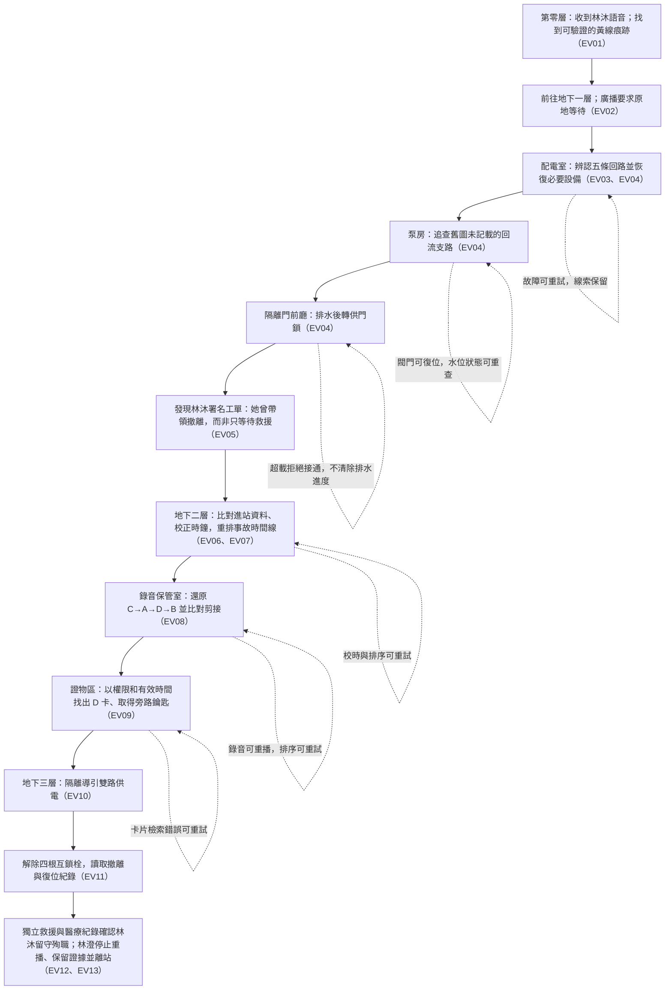

# 《黃燈之後》擴充版故事與製作計畫

> 本文件是未來擴充版的候選設計，不改寫目前短版的遊戲內容或結局。擴充版若獲團隊採納，應作為一套完整重編的主線版本製作；在此之前，現行 `content/story.json` 仍是短版遊戲的唯一故事來源。

## 一、版本定位

- **類型：** 第一人稱 2D 點擊式密室逃脫。
- **預估遊玩時間：** 約 45–60 分鐘。
- **場景：** 城市地底轉運站的第零層、地下一層維修層、地下二層檔案層、地下三層總控層。
- **故事目標：** 林澄沿著妹妹林沐留下的維修痕跡，完成一條中斷的撤離路線，查明第零層事故如何被掩蓋，並停止舊導引系統重播她的聲音。
- **擴充原則：** 先完成四層完整主線與一個告別結局，再考慮支線或額外房間。每個謎題都須有可重查線索、逐級提示及清楚操作回饋。

## 二、核心故事與情緒弧線

林澄是獲准進站停機與整理事故資料的維修員，因妹妹失蹤案主動申請本次工作。今晚 01:16 接通入口維修網路，01:17 收到以林沐為報修人的舊工單通知；附件將站務播報「末班車到了」接上她當年的巡查語音「聽見三聲就走黃線，別看站名」。畫面只顯示今晚送達，建立時間需展開詳情，林澄誤以為她仍在呼救。他已因核准派工進站，這則通知使他把資料保全任務當成救援妹妹的機會；即時求救只是初始假設。

第零層的廣播會提供部分真實資訊，例如某扇門確實通往維修層；但錄音被剪去上下文，例如把「不要重新接通通訊」接成「重新接通通訊」。玩家不能只靠聲音判斷方向，必須用工單、供電狀態、管線流向和原始紀錄驗證每項指示。剪接是舊摘要規則的缺陷，與事後有人刪改事故報告分開，不寫成系統有意識欺騙。

中段的情緒轉折發生於地下一層：林澄原先把林沐想成等待救援的人，卻從她保住照明、排水、轉供門鎖及維持手動放行的行動中，得知她當年正努力讓其他受困者離開。玩家完成的設備操作，正是她曾中斷的撤離程序。

地下二層揭露公布版本刪去了林沐的進站資料，並以她留下的錄音拼接廣播。地下三層證實 01:24 的封鎖由舊系統自動復位程序造成：程序沿用備援卡 D 權限，重新啟動導引並鎖回維修門；事後有人修改事故報告，責任者身分未能從現存紀錄確認。M-042 簽領、連續影像、救援個案 U-017-03 與獨立醫療移交副本共同支持林沐留守後未能生還；醫療原件當年未具名，身分關聯又被排除於對外回覆，林澄才持續以失蹤追查。林澄保存原始證據、停止重播並離站，完成告別。廣播聲音本身仍不能證明身分；結局以文件和設備紀錄交代，不呈現遺體、血腥或跳嚇畫面。

## 三、故事流程圖

節點編號對應 `docs/Expanded-Story-Verify.md` 的驗收項目。

## 四、分層內容與謎題

### 第零層：她在呼救

林澄收到妹妹名義傳來的語音，認為林沐仍在站內。入口、迴圈走廊與站務室承接短版已有的調查基礎。擴充版把反覆感落實為固定的環形走廊、被復位門禁送回入口的路徑，以及重複顯示的舊站牌；房間不瞬移。時鐘矛盾在地下二層以偏差校正回收，三聲是舊錄音重播標記。玩家以不變的實體標記和已供電路線，找到通往維修層的入口。第零層地圖、每次返回的門禁狀態與站牌差異仍須在製作時逐項實作驗收。

- **故事功能：** 建立「妹妹正在求救」這個合理但尚未證實的初始假設。
- **玩家目標：** 找到維修層入口及可重查的路線線索。
- **公平性：** 廣播只提供方向假設；地面標記、設備燈號和工單能獨立驗證路徑。

### 地下一層：維修層——被中斷的撤離

本層由三個可往返的小空間組成：配電室、泵房、隔離門前廳。主要目標是排除封住通道的積水，打開通往地下二層的隔離門。

#### 謎題一：辨認五條回路

玩家依工單、線束固定架、維修圖和插座形狀，將照明、通訊、排風、泵浦、門鎖排入五個插槽。

| 插槽 | 1 | 2 | 3 | 4 | 5 |
| --- | --- | --- | --- | --- | --- |
| 正確回路 | 照明 | 通訊 | 排風 | 泵浦 | 門鎖 |

**線索條件：**

1. 照明在通訊左側；排風在通訊右側，左右不要求相鄰。
2. 門鎖緊接在泵浦右側。
3. 通訊與泵浦之間恰好隔一個插槽。
4. 排風插頭無法接進第五槽。
5. 五條回路各用一次。

**答案核對：** 唯一符合排列為「照明、通訊、排風、泵浦、門鎖」。介面應逐條顯示有效回路反應；排列錯誤可重排，不清除已找到的文件。

#### 謎題二：找出排水失效的回流支路

啟動泵浦後水位仍不下降。舊管線圖缺少一條新增支路。玩家停止排風機後，從檢修窗沿管線追蹤流向，發現泵浦出口被接回入口。

| 閥門 | 管線用途 | 正確狀態 |
| --- | --- | --- |
| A | 積水槽 → 泵浦入口 | 開 |
| B | 泵浦出口 → 排水井 | 開 |
| C | 泵浦出口 → 泵浦入口（回流） | 關 |
| D | 泵浦出口 → 封存室 | 關 |

**答案核對：** A、B 開啟，C、D 關閉。水位只在這個通路成立後下降。C 支路的新增接頭和不同批次的固定扣可證明管線被改接，但尚不足以判定改接者或動機。

#### 謎題三：排水後把電力轉給門鎖

總供電上限為 4 格；應急照明 1 格、通訊 1 格、排風 1 格、泵浦 3 格、門鎖 2 格。水位感測器會在水位高於安全線時禁止開門。止回閥在停泵後關閉，避免積水倒流。

**必要步驟：**

1. 關閉通訊及排風，保留 1 格應急照明。
2. 啟動泵浦（照明 1 + 泵浦 3 = 4 格），排水至安全線。
3. 停止泵浦；確認止回閥關閉且水位仍安全。
4. 將電力由泵浦轉給門鎖（照明 1 + 門鎖 2 = 3 格）。

超過負載或水位仍高時，面板顯示所需電力／保護原因；已完成的回路與管線狀態保留，可立即調整重試。廣播要求保持通訊，但玩家能從負載標示和感測器驗證此指令會妨礙撤離。

隔離門內側放置林沐署名的工單：「照明保留。先讓走廊的人出去。」這是玩家第一次取得她曾主動帶領撤離的明確證據，完成情緒轉折。

### 地下二層：封存層——被刪掉的七分鐘

本層由監控室、錄音保管室、證物取件區組成，三處可自由往返。玩家目標是依當年權限索引找出正確保管格，領用工作井與升降梯共用的檢修旁路鑰匙，並讀取覆寫命令原稿的掃描副本。這裡的難度來自校正兩台備援時鐘、還原錄音順序，再判定哪張維修卡在關鍵操作時仍有效。

#### 謎題四：校正時間線

監控室的校時測試把兩台備援時鐘與標準時間對照：標準時間 01:10 時，控制終端顯示 01:12，監視錄影顯示 01:09。設備說明指出事故期間兩台時鐘沒有重置，因此控制終端快 2 分鐘、監視錄影慢 1 分鐘。玩家需將終端時間減 2 分鐘、將錄影時間加 1 分鐘，再依真實時間排序。

| 記錄來源 | 原始顯示 | 校正後 | 事件 |
| --- | --- | --- | --- |
| 控制終端 | 01:19 | 01:17 | 主電中斷 |
| 監視錄影 | 01:18 | 01:19 | 通訊回路被切斷 |
| 控制終端 | 01:22 | 01:20 | 排水完成 |
| 監視錄影 | 01:21 | 01:22 | 維修門放行 |
| 控制終端 | 01:26 | 01:24 | 導引系統恢復，維修門重新鎖定 |

正確時間線為 **01:17 斷電 → 01:19 切通訊 → 01:20 排水完成 → 01:22 放行 → 01:24 重新封鎖**。玩家先從「門似乎早於排水完成」的矛盾開始，再找到校時測試作共同基準，最後排序。地下一層先前建立的「先排水、後放行」規則是合理性檢查，不可代替校正證據。正確時間線會定位錄音卷的封存時段。

#### 謎題五：還原妹妹當年的錄音

錄音保管室有四段原始片段。每段均附逐字字幕、波形／接縫標示及背景設備狀態；播放器可重播，靜音下仍能解題。依前題校正後的設備事件還原順序：

| 片段 | 台詞節錄 | 可驗證的背景與校正時間 |
| --- | --- | --- |
| C |「先切通訊，電要留給排水。」| 排風機正在停轉、泵浦尚未啟動；01:19 前後 |
| A |「水退了，讓他們過去。」| 泵浦仍在運轉、水位已退；01:20 |
| D |「你們先走，我留在這裡。」| 門閂收回，之後有離去腳步；01:22 |
| B |「不要重新接通通訊，會把維修門鎖回去！」| 門閂落下，接著出現三聲重播標記；01:24 |

因此原始片段順序是 **C → A → D → B**。排序依據是設備狀態及校正時間，不能只以台詞聽起來是否連貫推測；三聲只標示重播，不能單獨判定錄音時間。

播放器並排顯示原始片段與目前廣播的波形及文字。原句「不要重新接通通訊，會把維修門鎖回去！」被剪成「重新接通通訊。」被剪除的開頭、警告和可對齊的波形接縫都能看見。這讓林澄第一次聽見妹妹當年是在安排撤離；現在的廣播卻刪去警告，將他引往相反操作。

#### 謎題六：檢索當時有效的維修卡

證物取件區提供四張卡的權限與狀態。時間欄均標明來源；玩家須先依謎題四校正，才能比較卡片是否在覆寫操作時有效。

| 維修卡 | 權限 | 事故期間狀態 |
| --- | --- | --- |
| A | 門鎖、排水 | 有效 |
| B | 門鎖、導引系統 | 控制終端顯示 01:25 停用（校正後 01:23） |
| C | 通訊、導引系統 | 有效 |
| D | 門鎖、導引系統 | 有效 |

成功執行回報顯示，重新啟動導引系統並鎖回維修門的操作發生於校正後 **01:24**（控制終端原始顯示 01:26）。A 缺少導引權限，C 缺少門鎖權限；B 權限吻合但在 01:23 已停用；只有 **D** 同時有兩項權限且在 01:24 仍有效。

玩家先用成功回報的時間及所需權限推得 D；回報的憑證欄缺頁，不能在解題前直接顯示答案。檢索正確後，D 對應保管格提供檢修旁路鑰匙與完整列印掃描副本，才核對出憑證索引確為 D。紙上來源標示「地下三層・總控終端」，證物原件留庫（D04、D05）。這能證明撤離開始後，總控以當時有效的 D 權限重新鎖門；卡號不代表有人在現場刷卡。這裡尚不能判定由人操作還是自動程序觸發；地下三層再查設定與執行回報。錯誤檢索需明確回覆「權限不符」或「當時已停用」，保留立即重試。

三題的資料會彼此支援：時間校正決定錄音事件順序，也決定 B 卡是否仍有效。玩家整理出的時間偏差與事件順序應自動記入調查筆記；推理仍由玩家完成。

- **本層結尾問題：** 林沐已讓撤離開始，總控室為何又把門鎖回去？
- **呈現取捨：** 本層只展示可核對的總控執行記錄，不放第二人的模糊身影；觸發方式留到地下三層查證。
- **可得結論：** 確認重新封鎖確實發生、D 卡有適當權限且當時有效。
- **仍未知：** 指令是人工或自動觸發、為何恢復門禁，以及聲音的錄製與送達時間。

### 地下三層：總控層——最後一次復位

本層由配電觀察室、檢修區、人工控制室及升降梯出口組成。玩家要查明 01:24 重新封鎖的機制，並親手建立安全離站路徑。地下二層取得的覆寫列印紙需保留排程編號 **R-0124-07**；玩家在總控終端用此編號找到復位記錄。

**本版結論：** 01:24 的封鎖由舊系統自動復位程序造成。排程 R-0124-07 沿用備援卡 D 的權限，恢復導引並重新鎖上維修門；它遵循過時的復位規則，沒有辨識正在進行的撤離。事後有人修改事故報告，刪去林沐的進站與救援紀錄，以掩蓋系統失效；現存稽核資料無法確認修改者姓名。地下三層的設定記錄、執行回報及修改後原稿共同支持這個結論，不以含糊人影或單一廣播定罪。

#### 謎題七：隔離導引雙路供電

配電觀察室有四個開關。舊圖只畫主電；玩家依設備銘牌的「雙路供電」提示，透過另一側檢修窗追查後加裝的備援支路。

| 開關 | 控制範圍 |
| --- | --- |
| A | 主電分線，供照明、B 導引支路，以及獨立 K-CTRL 檢修控制支路 |
| B | 主電分線通往導引系統的支路 |
| C | 備援分線，供應升降梯及導引系統 |
| D | 備援分線通往導引系統的支路 |

目標是讓導引系統完全斷電，同時保留照明與升降梯供電。正解為 **關閉 B、D；保留 A、C**。只關 B 時，狀態面板需顯示「導引主電支路已隔離，導引備援支路仍在供電」，提示玩家沿檢修窗追查另一供電來源。其他錯誤開關可立即復位，不消耗道具。完成後，廣播停止，通往手動檢修區的安全罩解鎖；安靜本身成為可觀察的成功回饋。

#### 謎題八：解除四根互相連動的鎖栓

厚門有四根鎖栓及對應試動把手。拉動把手會反轉所連動鎖栓的狀態；每次變化可從觀察孔直接核對。

| 把手 | 會反轉的鎖栓 |
| --- | --- |
| A | 第 1、2 根 |
| B | 第 2、3 根 |
| C | 第 3、4 根 |
| D | 第 1、3、4 根 |

初始只有第 4 根伸出，目標是全部縮回。一個最短解為 **D → A → B**（A、B、D 各拉一次）；把手操作互相可交換，任何順序若最終達到全縮回都算成功。重複操作後只要最終狀態全縮回亦可開門，不要求完全照抄最短解。

| 步驟 | 仍伸出的鎖栓 |
| --- | --- |
| 起始 | 第 4 根 |
| 拉 D | 第 1、3 根 |
| 再拉 A | 第 2、3 根 |
| 再拉 B | 無；門開啟 |

維修手冊完整列出連動關係；每次操作後即時顯示四根鎖栓狀態，玩家不必背住變化。進入人工控制室後，玩家找到妹妹曾送出的遠端撤離請求及成功執行回報。隨後的復位記錄顯示撤離被取消；排程編號與地下二層的 R-0124-07 相同。這說明林沐當時已讓撤離開始，問題在另一套仍運行的控制規則。

#### 謎題九：安全停機並建立離站路徑

最後整合題有四項操作：保存原始事故記錄與未剪輯錄音、停用自動復位並確認「執行完成」、隔離主控室電源、使用旁路鑰匙解除升降梯駐停鎖。

安全條件分散在三處設備文件，並在 D13 合併列示：

- 終端說明：切斷主控電源後，未備份資料將無法讀取。
- 復位程序記錄：只斷電不會取消排程，重新供電後仍可能恢復封鎖。
- 升降梯檢修牌：人工釋放駐停鎖前，必須隔離主控並保留備援供電。

地下二層的判斷再次適用：「指令已接收」不等於「執行完成」；需核對停用回報。

因此，**備份證據**與**停用復位**可任意先後，停用須核對「執行完成」。軟體的「安全停機」在條件不足時拒絕；實體 K-CTRL 開關仍能提前斷電，玩家可手動復電補做。斷電只使資料暫不可讀，不會刪除原件；正式停用設定寫入非揮發儲存，復電仍保留。離站須同時具備備份完成、停用完成、K-CTRL 已隔離、C 備援有電及旁路鑰匙解鎖。B/D 只切導引輸出，檢修終端仍由 A→K-CTRL 供電；最後切 K-CTRL 也不切 A 照明或 C 升降梯，沒有「關廣播後無法讀終端」的死結。詳見 D13。

通關前的連續影像呈現：林沐先引導人群到門前，再返回泵房維持故障把手；01:22 放行，人群通過，01:24 復位覆寫把手。當年保持扣損壞、原檢修口被坍物阻塞，解釋她為何不能跟著走、救援為何延誤。今夜安全處置已修復保持扣並清通檢修通路，所以玩家不必再留一人犧牲（D01、D02、D08、D09）。

救援以 U-017-03 未具名登錄，醫療回報只確認同碼個案送達時已無生命跡象，外部保有原件。M-042 簽領、連續影像、救援位置與移交碼建立她的身分關聯；T-017-R2 與前後稿顯示內部曾有待核對資料，卻刻意排除於對外回覆，使林澄只得到「未進站」。這能證明刪改，不能從共用帳號指認個人，也不能推斷精確死亡時間或死因（D07–D11）。

Q-017 則解釋今晚的聲音：林沐當年 01:23 建立離線報修，01:25 才封存附上當班錄音；今晚維修網路恢復後於 01:17 補送。建立、錄音與送達時間不能混為一談。原音索引能逐句對照開場、警告及摘要剪接，沒有系統憑空知道哥哥到來或妹妹仍在線的設定（D12）。

林澄唯讀保存原件，另製身分關聯與更正申請副本；不直接改原始名冊。他停用重播、保留照明並搭升降梯離站。尾聲只交代外部已受理重新核對，並非按鍵即平反。最後一句：「她不是在等末班車。她留在那裡，直到最後一個人離開。現在，換我走出去。」畫面不呈現遺體、血腥或跳嚇；告別以證據與行動完成（D14）。

本層難度逐步提升：先追查兩路供電，再推算互鎖狀態，最後整合跨樓層證據和安全操作條件。每題都有可見設備變化、可重查記錄及可恢復的錯誤回饋。

## 五、提示、介面與無障礙

- 每題提供三級提示：第一級指出觀察區域；第二級指出線索之間的關係；第三級提供一個推理起點或操作順序，但不自動解題。
- 文件、工單、路線與設備狀態可重看；不得要求玩家記住未記錄的數字。
- 音訊都附繁體中文字幕、文字稿及波形／節奏圖；靜音仍可完成所有謎題。
- 電力、水位、閥門與門鎖狀態以文字及圖示雙重呈現。
- 錯誤操作使用溫和回饋；不使用追逐、頻閃、突然爆音或限時懲罰。
- 提供鍵盤焦點、大字、字幕、音量控制和減少動態選項。

## 六、美術與音效方向

- 以一致的 2D 點擊式場景呈現四層空間，透過少數可驗證的狀態差異表現異常，不製作複雜動態迷宮。
- 地下一層以氧化金屬、舊式配電標籤、積水反光和清楚可追蹤的管線構圖為主；線索需有足夠對比。
- 工單、管線圖、接點與面板必須以可讀字體製作；互動熱點在滑鼠及鍵盤焦點時均有清楚提示。
- 環境音採低音量風管、泵浦、繼電器及管線水聲。重要狀態另有視覺回饋；聲音不作唯一解題依據。
- 素材未完成前只記錄為製作需求，不宣稱已有成品；外部素材依 `Credits.md` 記錄來源、作者與授權。

## 七、版本與製作順序

1. **內容鎖定：** 本版採自動復位造成封鎖、事後修改報告的真相，以及林沐留守殉職的告別結局；若團隊修改，先更新兩層以上的佐證，再進入實作。
2. **內容 TDD：** 先把層級、線索、提示、答案、文件關聯與結局寫入獨立擴充內容資料，為一致性規則建立測試。
3. **垂直切片：** 先完成地下一層三個空間及三題，驗證往返、設備狀態保存、提示與回饋。
4. **故事整合：** 加入地下二層證據鏈及地下三層停機結局；確認所有揭露都有早先線索支持。
5. **素材製作：** 依場景清單製作並逐項記錄授權；確認縮放、繁體字形和文字對比。
6. **擴充版驗收：** 依 `docs/Expanded-Story-Verify.md` 執行內容與故事驗證，之後才考慮額外結局或支線。

## 八、因果與證據交接

完整文件原文、出現位置及推論界線見 [可讀證據](Expanded-Story-Evidence.md)，事故當晚／事故後／今晚的時間分開記在擴充 JSON 的 `timeline`。故事文件是提案，不是現實事故資料。

| 必須解答的問題 | 玩家可核對的資料 |
| --- | --- |
| 她為何留下，玩家卻能走？ | D01–D03、D08：故障把手與今夜修復的差異 |
| 醫療有紀錄，哥哥為何不知？ | D07–D11：匿名個案、待核對關聯與對外刪改 |
| 為何一年後才收到語音？ | D01、D12：網路復通、舊佇列、建立／封存／送達分開 |
| 誰造成封鎖，誰修改報告？ | D04、D06、D11：自動觸發與事後人工刪改分開，不能指認個人 |
| 關廣播後如何再讀終端？ | D13：導引輸出與控制器電源分開，實體斷電可復原 |
| 怎麼替她留下名字？ | D14：保全原件，另作更正申請，交外部核對 |

以上新增文件在相應揭露當下或之前可取得，不得只在結局旁白宣告答案。B2 的時間與卡片題仍由玩家推理，D04 不提前明示觸發方式；B3 再揭露自動排程。
