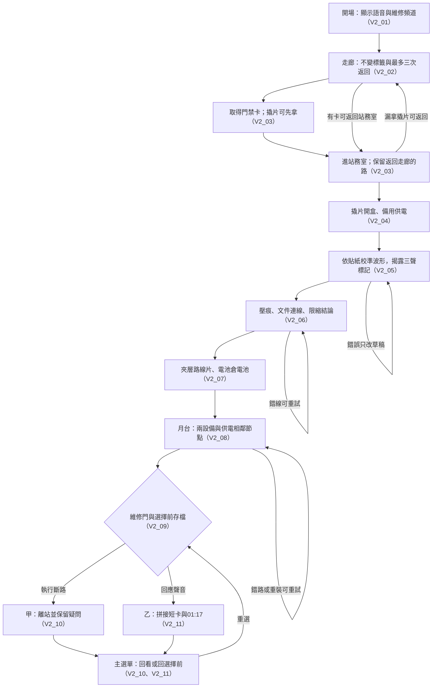

# 03｜謎題規格表、狀態與驗收草案

**2026-11-03 使用者按預設核准；實作與測試結果見 Test.md。** 劇情事實只取本次最終提示；下列確切位置、答案與狀態欄位是為可玩性補齊的設計提案。確認後，故事、對白、線索、答案、提示與結局統一寫入 `content/story.json`，程式不另藏一份相反的答案表。舊 _legacy_docs/ 僅作歷史來源，不載入為新版規則。

## 單一事實來源的邊界

- 角色：維修員林澄；妹妹林沐一年前在第零層事故失蹤，官方否認她曾進站。
- 開場逐字呈現：「末班車到了。聽見三聲就走黃線，別看站名。」手機顯示林沐、站內維修頻道；此時不確定真實發送者。
- 只確認舊導引系統拼接／重播聲音，林沐曾試圖關閉它，三聲是重播標記，官方紀錄有改動。不指認改動者，不確認廣播是否為本人，更不新增生死／意識上傳等結論。
- 只有迴圈走廊、站務室、月台三個可行走場景；紀錄櫃是站務室近景面板，不另算第四張房間。
- 只有門禁卡、撬片、透明路線片、電池四件關鍵物品；不保留名牌、M0 支線答案或旋轉／固定路線片的前置。

## 謎題規格總表

| ID／場景 | 前置條件與可見證據 | 答案／完成操作（已核准） | 成功狀態變化 | 失敗回饋與恢復 |
| --- | --- | --- | --- | --- |
| P01 迴圈走廊 | 開場完成；飲水機內側有固定圖示，指向同一走廊的門禁卡檢修槽；推車上撬片直白可見 | 檢查標籤指示的檢修槽取卡，再在盡頭門使用卡；不要求三輪或鞋印推論 | cardOwned、doorAccess＝true；進站務室；loopCount 停止增加。撬片可先拿或之後回來拿 | 無卡過門則回同一走廊，僅 loopCount 0→1→2→3；超過不增加變化。提示「門禁燈未啟動，標籤似乎留了位置。」無時間／物品損失 |
| P02 站務室／電力 | 撬片在背包；檢修盒卡住。未拿撬片可隨時返回走廊 | 使用撬片開盒，再操作盒內備用電源開關 | boxOpen、backupPower＝true；控制台可看見波形。撬片不消耗 | 錯道具：「邊緣需要一片薄而結實的工具。」保留道具及盒蓋狀態；不因點錯關閉已開啟盒蓋 |
| P03 站務室／波形 | backupPower＝true；牆貼有長／短／雙短三組符號；控制台三個波形附同等文字與重播 | 依貼紙左到右選入長→短→雙短；可刪一格或清本次草稿 | broadcastUnlocked＝true；播放帶字幕剪接訊息，筆記記下三聲重播標記；紀錄櫃開放 | 「波形次序尚未吻合。」只指出本次校準未通過，保留電力、已得文件；可改草稿或清空。靜音完全可解 |
| P04 站務室／紀錄櫃 | broadcastUnlocked＝true；報告、維修簿、名冊皆可重讀；刮除簽名可點「側光檢視」顯示壓痕 | 先讀壓痕；連 01:17↔凌晨一點十七分，再連「林沐從未進站」↔林沐簽名；選限縮結論「紀錄有人為改動，仍不能確認當下聲音身分」 | impressionSeen、recordsCompared＝true；夾層的路線片可取、控制台電池倉彈出電池；兩獎勵不會自動消失；兩者可取後開往月台 | 「這兩項尚不足以互相印證。」錯線可取消；已驗證正確連線與筆記保留。猜到名冊答案但未看壓痕時提示需先檢查刮除處，不暗中判定成功 |
| P05 月台／供電路線 | recordsCompared＝true；路線片及電池各可帶往月台；兩設備互相獨立，可先裝任一件 | 電池→指示燈箱，路線片→圖面定位槽；依琥珀供電燈沿相鄰節點「入口→分岔→檢修→出口」連成唯一路徑 | batteryInstalled、filmMounted、currentPathValid＝true；routeSolvedEver、doorUnlocked＝true，門閂保持開啟；建立最後選擇前檢查點 | 未裝設備時提示檢查缺件；誤選未供電或不相鄰節點，只拒絕本次延伸，不清正確前綴。重試不限次，不消耗電池或路線片；清路線只清本次連線 |

**四格背包規則：** 四種物品各有固定格；卡與撬片使用後保留。路線片及電池在背包／設備間互斥，取回放回原格。不可丟棄、出售、任意合成或把唯一物品用在錯設備上消耗。P04 重複驗證只重現已知結論，不重複發獎；未取獎勵始終留在物件上。

## P01：四個可對照快照（入口＋最多三次返回）

| 快照 | 場景鐘面 | 站牌箭頭 | 水漬 | 系統本輪唯一變更 |
| --- | --- | --- | --- | --- |
| 入口 0 | 01:16 | 向右 | A 形狀 | 無 |
| 返回 1 | 01:17 | 向右 | A 形狀 | 分鐘 |
| 返回 2 | 01:17 | 向左 | A 形狀 | 箭頭 |
| 返回 3 | 01:17 | 向左 | B 形狀 | 水漬形狀 |

標籤、卡槽與推車位置不變；水漬不引入鞋印開門的新規則。玩家拿走的道具不復活，此類玩家行為不算系統每輪變更。拿卡即可退出；從站務室回走廊不再觸發迴圈，避免為找撬片被鎖回重複空間。

## P03／P04：可讀證據及答案來源

- 校準貼紙顯示三組順序符號：長 ━、短 ▪、雙短 ▪▪；這是校準組的次序，不是廣播的「三聲」。
- 廣播出現兩段相同的三個重播標記，字幕與波形均顯示相同間隔；此時才讓玩家懷疑開場是重播。牆貼不提前寫「妹妹不是真的」。
- 報告條目：事故當夜 01:17 無列車進站，並保留官方對林沐未進站的說法。
- 維修簿條目：事故當夜凌晨一點十七分緊急斷電；補一段已指定真相的可見記載：「林沐曾嘗試停用舊導引系統；系統會拼接乘客聲音，三聲是重播標記。」此條為已核准文案，不增加操作結果或幕後人物。
- 名冊：只顯示被刮掉簽名的壓痕為林沐。不得再補林沐生死、傳訊時間或誰刮除的證據。
- 兩條線的關係分別顯示「同一分鐘」與「互相矛盾」；不能把相容的事件描述冒充矛盾。時間吻合本身不證明造假，署名被刮除及官方否認才構成新版要玩家檢查的問題。
- 兩條線可用點起點再點終點，鍵盤也能選端點；不用辨認極小筆跡。壓痕一旦檢視，筆記保存清晰文字版。

## P05：路徑規則

提案節點 ID 為 entry、junction、service、exit、north、echo；後兩者是未供電的錯誤站名分支，不增加新房間。有效相鄰邊只有 entry–junction、junction–service、service–exit；另保留 junction–north、service–echo 為可看見但不供電的支線。

圖面上每個有效節點以穩定琥珀燈＋實心連接符號＋文字「供電」呈現；未供電用空心符號與文字，不只靠辨色。起點與終點有不同形狀；廣播字幕明寫「站名與燈號不符」。透明片單一定位槽自動對齊，不要求旋轉或名牌固定。

## 每題三級提示（不自動解題）

| ID | 1：觀察方向 | 2：具體物件 | 3：操作方向 |
| --- | --- | --- | --- |
| P01 | 「有些東西改了，也有東西一直沒變。」 | 「看看飲水機內側的維修標籤，還有清潔推車。」 | 「依標籤圖示檢查卡槽；拿到門禁卡後，在盡頭門使用。撬片可一併帶走。」 |
| P02 | 「控制台沒有電，先找出備用電路。」 | 「檢修盒蓋邊緣有窄縫；推車上有合適工具。」 | 「把撬片用在盒蓋，再操作盒內電源開關；沒拿工具可沿原門返回。」 |
| P03 | 「波形的長度與段數也能用眼睛比較。」 | 「牆貼三個記號，對應控制台三段波形。」 | 「由左至右逐格對應牆貼記號；可移除一格或清本次草稿，再核對。」 |
| P04 | 「找出哪些記錄描述同一件事，哪些卻互相否定。」 | 「對照兩種時間寫法，再檢查名冊被刮除的位置。」 | 「連相同分鐘、連人員紀錄的矛盾，再選出證據能支持且沒有過度推斷的結論。」 |
| P05 | 「先分清指路的聲音與仍供電的設備。」 | 「檢查指示燈箱、路線圖定位槽，以及亮起的琥珀燈。」 | 「放入設備後，由入口逐一連接相鄰的供電節點；忽略報站名稱。錯一步可改，不會失去道具。」 |

提示等級 0–3 記入存檔；再次打開不重新耗時或扣資源。第三級能說明手法，但不替玩家選答案或完成連線。

## 最終選擇、代價及存檔

| 結局 | 明確操作 | 必須回收的證據 | 後果與限縮敘事 |
| --- | --- | --- | --- |
| 甲 | 執行維修簿的斷路程序 | 三聲重播、林沐壓痕、斷電紀錄、供電路線 | 關閉導引／重播支路，保留應急照明；林澄帶著紀錄離站。代價是停止這段聲音，仍無法得知林沐下落；不寫成找到她或證明她死亡 |
| 乙 | 回應廣播中的聲音 | 已知道片段可拼接、名冊不能證明當下身分、出口已打開 | 短場景卡只播放拼接字幕，單向淡出到 01:17。代價是暫時放棄離站並接受聲音無法核實；沒有傷害或驚嚇。讀完按繼續返回主選單，提示可回選擇前 |

完成正確供電路徑時建立完整、可驗證的選擇前檢查點；最終選擇以持續成立的 doorUnlocked 為條件，取回設備不覆寫這份檢查點。存檔保存 storyRevision、場景、位置、背包／設備、謎題旗標、快照、已讀文件、提示及已看結局；另存 lastEnding 與 choiceCheckpoint。通關不能把唯一檢查點覆蓋成不可再選；載入可重看上次結局或回最後選擇前。另開新遊戲才會要求清除確認。

## 防死局狀態契約（確認後才實作測試）

1. 回站務室的門禁卡不會消失；走廊與站務室雙向可走，先拿卡但漏拿撬片仍有解。
2. 已得進度（卡／撬片曾取得、盒蓋、備用供電、廣播、壓痕、紀錄比對、routeSolvedEver、doorUnlocked）只從未完成變完成。當前裝配及 currentPathValid 為可重算狀態，不與已解鎖進度混用；錯誤只改本次草稿或給回饋。檢修盒不被錯點鎖回去。
3. 獎勵領取、設備安裝與重複確認冪等；同一物品不能同時在設備和背包，也不能兩處都不存在。
4. 月台返回站務室、返回已讀檔案均可用；取回電池或路線片會取消 currentPathValid 與本次連線，保留已得線索；routeSolvedEver／doorUnlocked 一旦成立便不回退，門閂不因取回設備鎖回去。重裝可再次校正，不能讓已打開出口失去可達性。
5. 場景邊界與門觸發有進出鎖，角色進門後出現在可走地面，不會在同一幀反覆傳送。外觀變化不改碰撞圖。
6. 關閉面板、暫停、靜音、改字級、減少動態、重載都不消耗物品或進度。面板關閉後焦點與角色控制可恢復。
7. 隨機數、真實時鐘、提示次數與操作時間不參與答案。玩家可無限重試，沒有失敗倒數。
8. 存檔必須驗證前置一致性；若損壞，嘗試上一份已驗證快照，失敗則明確告知，不靜默假裝通關或刪除檔案。

## Verify.md 新版對應（舊 Verify 原稿保留）

| ID | 後續可檢查的預期行為 |
| --- | --- |
| V2_01 | 開場只顯示指定語音、林沐顯示名稱及維修頻道；不提前確認發訊者或重播真相 |
| V2_02 | 入口＋最多三次返回各只改一項；標籤與卡位不變；未繞滿也可拿卡離開 |
| V2_03 | 卡、撬片唯一；漏拿撬片可返回；錯道具不消耗 |
| V2_04 | 撬片開盒後才可供電，供電後才顯示校準波形 |
| V2_05 | 貼紙／波形／字幕／答案一致，靜音可解，三聲重播與校準組分開 |
| V2_06 | 壓痕可看、兩條證據線可重試；不從相容紀錄推出篡改者或當下廣播身分 |
| V2_07 | 成功後路線片及電池來源正確、可領且不重複發；四格背包不溢出 |
| V2_08 | 兩設備可任意安裝順序，正確供電路徑唯一；錯分支、跳步、取回／重裝皆可恢復 |
| V2_09 | 路線完成才開維修門；可建立可恢復的選擇前檢查點 |
| V2_10 | 結局甲回收證據、交代代價並保留未知；可載入回看及重選 |
| V2_11 | 結局乙只有安全短卡、01:17、返回主選單與重選；存檔保留通關記錄 |
| V2_12 | 每個可達非終局抽象狀態仍能到達選擇與兩個結局；位置圖可達、錯誤不造成唯一資源遺失 |
| V2_13 | 三級提示、筆記、字幕、大字、音量、靜音與減少動態正常，無頻閃／爆音／抖鏡 |
| V2_14 | 素材不透明色最多 32（本案 18）；批准字色組 ≥4.5:1；動態渲染及可及閱讀層另驗 |
| V2_15 | 每項實際入庫素材有來源、作者、授權、必要署名及檔案雜湊；繁體字形完整 |
| V2_16 | 三場景、四方向各四幀、整數縮放與最小視口符合規格；無農場元素與參考素材 |

## 正確流程圖（主要節點名稱唯一，括號標 Verify.md）

圖中的迴圈只表示可恢復操作，不表示已設計無限場景或新結局。跨流程的 V2_12–16 另由狀態、可及性及素材測試驗收。

## 俯視角操作與檢查範圍

鍵盤以 WASD／方向鍵四方向行走，E 檢查鄰近一格內物件；同時按兩軸不產生斜走。點擊可行走地面提供四鄰格尋路，觸控也可移動；接近物件後點擊檢查。遠距點擊不直接越牆取物。面板、背包與連線皆有點擊及鍵盤等效操作，不以拖曳作唯一手段。地圖需預留每件必要設備至少一個可達互動落點。

## 自動驗收的實施方案與證據邊界

- 以同一份 story.json 資料驅動有限抽象狀態圖；遍歷全部可達狀態，反向搜尋結局可達性，要求每個非終局皆有路徑可達結局，並能回到選擇前到達甲／乙。無限的遊玩秒數與滑鼠座標不放入此圖。
- 對三張場景碰撞圖逐一做可行走區域搜尋，核對每種解鎖狀態下，必要互動點與返回門可達；沒有任何程序動畫能把人卡進障礙。
- 加上先卡後撬片、先電池後路線片、漏看壓痕、連錯／跳步、重複領獎、安裝後取回、半途關面板、任一謎題後重載、甲乙結局後讀檔的反例測試。
- 模型檢查通過仍不能證明實際 Phaser 輸入、碰撞或瀏覽器存儲永不故障；須另有完整瀏覽器通關、靜音／鍵盤／觸控替代與存檔回歸。不能宣稱已證明任何原始操作序列都必定完成。
- 色板腳本後續計算去除全透明像素後的實際素材色數、批准文字配色的未四捨五入對比值；不掃參考截圖來建素材色板，不把 UI 濾鏡的合成色忽略成已通過。
- 15–20 分鐘只作目標：開場約 1、走廊 3–4、電力／波形 3–4、紀錄櫃 4–5、月台 3–4、結局約 1 分鐘，合計約 15–19；需新玩家盲玩確認，不強迫等待湊足時間。
